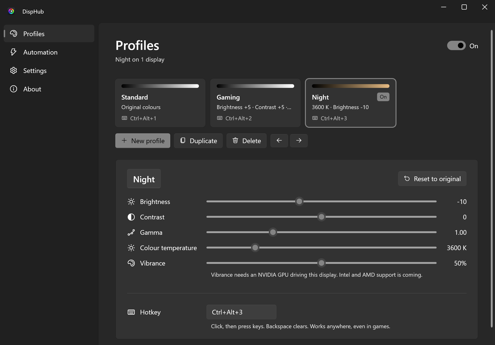

<h1 align="center">
  <picture>
    <source media="(prefers-color-scheme: dark)" srcset="docs/images/wordmark-dark.png">
    
  </picture>
</h1>

<p align="center">
  Display profiles for Windows: gamma, contrast, brightness, colour temperature and vibrance,<br>
  switched with a hotkey, per app or on a schedule.
</p>

<p align="center">
  
</p>

## What it does

- **Profiles.** Save looks such as "Gaming", "Night" and "Photo editing" and switch with one click,
  a global hotkey or the tray menu. A small on-screen message confirms the switch without stealing focus from games.
- **Every monitor.** Colours apply to all connected displays, and DispHub can leave chosen displays alone.
- **Vibrance.** Saturation on NVIDIA, Intel and AMD (beta) graphics, so it also works on the built-in screen of most laptops.
- **Screen effects (Pro).** Make the whole screen look like film, VHS, a CRT, a Game Boy or an amber terminal, dim it below
  its lowest brightness, turn it greyscale or red at night, or help with colour blindness. Every look is adjustable,
  shows in a before and after preview, and can be saved, shared as a link or picked by a profile. Drawn on the GPU.
- **Templates and links.** Start a profile from a template, or share one as a `disphub://` link.
- **Automation (Pro).** Switch profiles while a specific game or app is in front, and fade to warmer colours
  at night on a schedule, from sunset to sunrise or at set hours.
- **Safe.** Your original colours are saved before anything changes and restored when you turn DispHub off or quit,
  even after a crash.
- **Private.** No account, no telemetry. Everything stays on your PC.

## Get it

DispHub will be available on the Microsoft Store. The Store version is free with three profiles; a one-time **Pro** upgrade
adds screen effects, automation, per-display settings and unlimited profiles, and supports development.

You can also build it yourself (below); builds from source include every feature.

## Graphics support

| Feature | Works with |
| --- | --- |
| Gamma, contrast, brightness, colour temperature | Any GPU (Windows gamma ramps). Not available while HDR is on. |
| Vibrance | NVIDIA and Intel (including laptop screens on Intel graphics). AMD is in beta: please report how it works for you. |

Windows only allows moderate colour changes by default. For very warm night colours, DispHub can lift that limit
for you (Settings > Displays > Full colour range; needs administrator approval once).

## Questions

**Do people watching my stream or screen share see the changed colours?**
No. DispHub changes colours in your graphics card's output, after Windows has drawn the screen, so OBS, Discord,
Teams and screenshots capture the original colours. Your viewers see a normal picture while you see your profile.

**My night profile isn't as warm as I set it.**
Windows limits how far colours can change by default. Turn on Settings > Displays > Full colour range (asks for
administrator approval once).

**Nothing changes on my HDR screen.**
Windows doesn't allow gamma changes while HDR is on. Vibrance still works.

## Help make it better

- **Translate** DispHub into your language on [Crowdin](https://crowdin.com/project/disphub). No coding needed.
- **Share a look**: copy a profile or an effect look as a link and post it anywhere.
- **Report a bug** with About > Copy diagnostics, or read [CONTRIBUTING.md](CONTRIBUTING.md) to send code.

## Build from source

Requirements: Windows 10 2004 or later and the [.NET 10 SDK](https://dotnet.microsoft.com/download/dotnet/10.0).

```powershell
git clone https://github.com/qlintenFX/DispHub.git
cd DispHub
dotnet run --project src/DispHub
```

Run the tests with `dotnet test --project tests/DispHub.Tests/DispHub.Tests.csproj`.
See [CONTRIBUTING.md](CONTRIBUTING.md) before opening a pull request.

## Licence

DispHub is free software under the [GNU General Public License v3.0 or later](LICENSE).
Third-party components are listed in [THIRD_PARTY_NOTICES.md](THIRD_PARTY_NOTICES.md).

The DispHub name and icon are not covered by the GPL. If you publish a modified version, please give it a
different name and icon so people don't confuse it with the official app.
