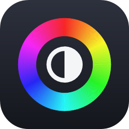

<p align="center">
  
</p>

<h1 align="center">DispHub</h1>

<p align="center">
  Display profiles for Windows: gamma, contrast, brightness, colour temperature and vibrance,<br>
  switched with a hotkey, per app or on a schedule.
</p>

<p align="center">
  
</p>

## What it does

- **Profiles.** Save as many looks as you like ("Gaming", "Night", "Photo editing") and switch with one click,
  a global hotkey or the tray menu. A small on-screen message confirms the switch without stealing focus from games.
- **Every monitor.** Colours apply to all connected displays, and DispHub can leave chosen displays alone.
- **Vibrance.** Saturation on NVIDIA and Intel graphics, so it also works on the built-in screen of most laptops.
- **Presets.** Add a ready-made look from the community gallery, or share your own as a `disphub://` link.
- **Automation (Pro).** Switch profiles while a specific game or app is in front, and fade to warmer colours
  at night on a schedule.
- **Safe.** Your original colours are saved before anything changes and restored when you pause or quit,
  even after a crash.
- **Private.** No account, no telemetry. Everything stays on your PC.

## Get it

DispHub will be available on the Microsoft Store. The Store version is free; a one-time **Pro** upgrade adds
automation, per-display settings and unlimited profiles, and supports development.

You can also build it yourself (below); builds from source include every feature.

## Graphics support

| Feature | Works with |
| --- | --- |
| Gamma, contrast, brightness, colour temperature | Any GPU (Windows gamma ramps). Not available while HDR is on. |
| Vibrance | NVIDIA and Intel (including laptop screens on Intel graphics). AMD support is planned. |

Windows only allows moderate colour changes by default. For very warm night colours, DispHub can lift that limit
for you (Settings > Displays > Full colour range; needs administrator approval once).

## Build from source

Requirements: Windows 10 2004 or later and the [.NET 10 SDK](https://dotnet.microsoft.com/download/dotnet/10.0).

```powershell
git clone https://github.com/qlintenFX/DispHub.git
cd DispHub
dotnet run --project src/DispHub
```

Run the tests with `dotnet test --project tests/DispHub.Tests/DispHub.Tests.csproj`.
See [CONTRIBUTING.md](CONTRIBUTING.md) before opening a pull request.

## Licence

DispHub is free software under the [GNU General Public License v3.0 or later](LICENSE).
Third-party components are listed in [THIRD_PARTY_NOTICES.md](THIRD_PARTY_NOTICES.md).

The DispHub name and icon are not covered by the GPL. If you publish a modified version, please give it a
different name and icon so people don't confuse it with the official app.
